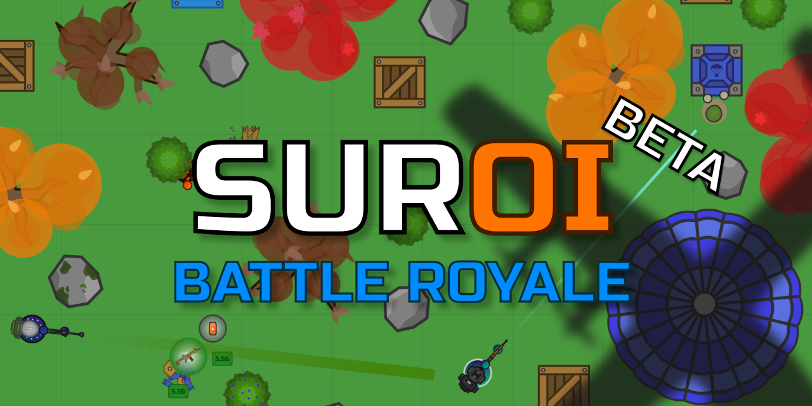

<div align="center">
  
  <hr>
</div>

<div align="center">
  
  
  
  
  
  
  <br>
  
  
  
</div>

## About
Suroi is an open-source 2D battle royale game inspired by [surviv.io](https://survivio.fandom.com/wiki/Surviv.io_Wiki). It is currently a work in progress.

## Play the game!
[suroi.io](https://suroi.io)

## Donate!
Any amount helps! All donation money goes towards the game directly.

[ko-fi.com/suroi](https://ko-fi.com/suroi)

## Join the Discord!
[discord.suroi.io](https://discord.suroi.io)

## Installation and setup
Start by installing [Git](https://git-scm.com/) and [Bun](https://bun.sh).

Use the following command to clone the repo:
```sh
git clone https://github.com/HasangerGames/suroi.git
```

Enter the newly created `suroi` directory with this command:
```sh
cd suroi
```

Finally, run this command in the `suroi` directory to install dependencies:
```sh
bun install
```

## Development
To start the game locally, run the following command in the project root:

```sh
bun dev
```
Or, to see output from the server and client separately, you can use the `bun dev:server` and `bun dev:client` commands. (Both must be running simultaneously for the game to work.)

To open the game, go to http://127.0.0.1:3000 in your browser.

## Production
To build the client for production, run this command in the project root:
```sh
bun build:client
```

To start the game server, run this command:
```sh
bun start
```

Production builds are served using [NGINX](https://nginx.org). Visit [the wiki](https://github.com/HasangerGames/suroi/wiki/Self%E2%80%90hosting) for details on how to self-host.

## Quick deployment with Docker
The repository ships with a Docker setup (`Dockerfile`, `docker-compose.yml`) so you can deploy a new version in a few commands, without installing Bun or Node.js on the host.

### Prerequisites
- [Docker](https://www.docker.com/products/docker-desktop/) with Docker Compose (bundled with Docker Desktop)

### First deployment
1. Create your config files from the examples:
   ```sh
   cp config.example.json config.json
   cp clientConfig.example.json clientConfig.json
   ```
   - `config.json` configures the game server (map, max players, admin roles/passwords...).
   - `clientConfig.json` configures the client (region/server addresses shown in the server selector).

   Edit them before starting if you need non-default values. If `config.json` is missing the container auto-creates it from `config.example.json`; if `clientConfig.json` is missing the bundled default is used.

2. Build and start the container:
   ```sh
   docker compose up -d --build
   ```
3. Open http://localhost in your browser.

The server listens on port 80 by default. To use another port, change the `ports` mapping in `docker-compose.yml` (e.g. `"8080:80"`).

### Updating to a new version
```sh
git pull
docker compose up -d --build
```
Compose rebuilds only the layers that changed (dependencies are cached), so updates are fast. Your `config.json` and `clientConfig.json` live outside the image and are preserved.

### Configuration changes
Both config files are mounted as volumes, so you can change regions, map, max players, roles, etc. without rebuilding the image. `docker/nginx.conf` is mounted read-only as well, so routing changes also don't require a rebuild:
```sh
# edit config.json / clientConfig.json / docker/nginx.conf, then:
docker compose restart
```

### Game WebSocket address (`clientConfig.json`)
The client builds the game WebSocket URL like this (`client/src/scripts/ui.ts`):
`gameAddress.replace("<gameID>", gameID + offset) + "/play"`.

With the bundled server (main port `8000`, game N listening on port `8000 + N + 1`), use:
```json
"gameAddress": "ws://<your-host>/play/<gameID>",
"offset": 8001
```
so game 0 resolves to `ws://<your-host>/play/8001/play`, which NGINX routes to the game server bound to port 8001. `mainAddress` should point to the same host (e.g. `http://<your-host>`).

### Logs
```sh
docker logs -f suroi
```

### Notes for users in China
The `Dockerfile` and `.npmrc` already switch package/apt mirrors to domestic sources (npmmirror, Tsinghua TUNA) to speed up builds. Timeouts during `docker build` are usually caused by Docker Hub network issues; retry or configure a registry mirror in Docker Desktop settings.

### Services inside the container
| Path in container | Description |
|---|---|
| `/app/server` | Bun game server (auto-creates `config.json` on first start) |
| `/usr/share/nginx/html` | Static client files (incl. `clientConfig.json`) served by NGINX |
| `/etc/nginx/nginx.conf` | NGINX config: static files + reverse proxy (`/api`, `/team`, `/play/<port>/play`) |
